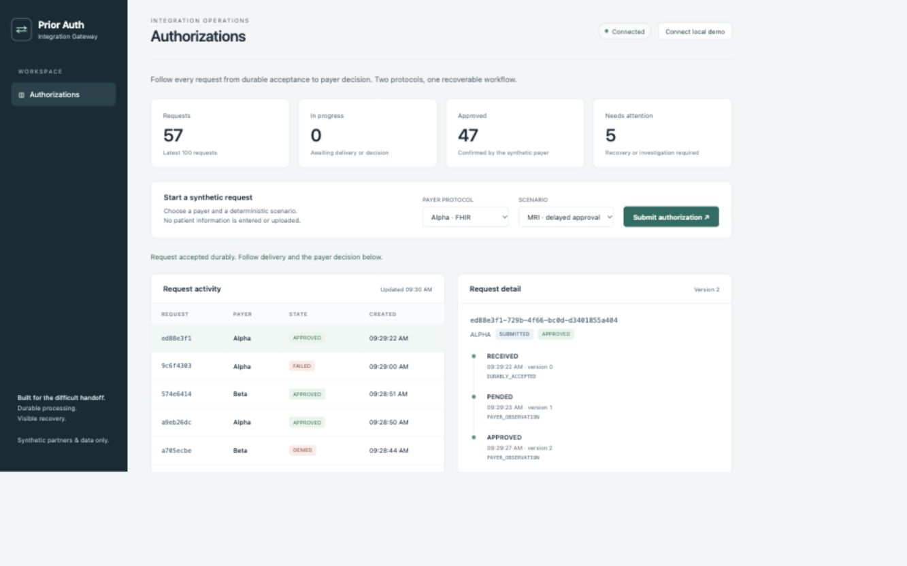
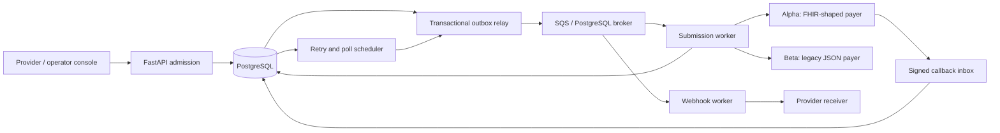

# Prior Auth Integration Gateway

A recoverable prior-authorization service with a FHIR R4 API, asynchronous payer integrations, and signed provider webhooks. PostgreSQL tracks each request from admission through delivery, payer decision, and recovery.

The project includes two synthetic payer services and a provider webhook receiver for local development.



## Features

- FHIR R4 bundle validation and translation into FHIR-shaped and legacy JSON payer protocols.
- Tenant-scoped access with JWT validation and OAuth client authentication.
- Transactional admission, idempotent request replay, and preserved partner submission payloads.
- Durable retries and polling with database leases and worker ownership checks.
- Signed callback processing with event deduplication, sequence checks, and retained conflicting observations.
- Signed provider webhooks with encrypted subscription secrets and explicit redelivery.
- Operator console with request timelines, delivery status, attempts, and recovery controls.
- Structured logs, OpenTelemetry traces, Prometheus metrics, and alert rules.

## Technology

| Component | Technology |
|---|---|
| API and workers | Python 3.12, FastAPI, Pydantic |
| Durable state | PostgreSQL 16, psycopg |
| Queue transport | Amazon SQS or PostgreSQL |
| Authentication | OAuth 2.0, JWT, private-key client assertions |
| Console | HTML, CSS, JavaScript |
| Local environment | Docker Compose, LocalStack |
| Infrastructure | Terraform, Amazon ECS Fargate, ECR, ALB, Secrets Manager |
| Development | uv, pytest, Hypothesis, Ruff, mypy, GitHub Actions |

## Run locally

Install Python 3.12, [uv](https://docs.astral.sh/uv/), Docker, and Docker Compose.

```sh
git clone https://github.com/kashishdesai01/Prior-Auth-Integration-Gateway.git
cd Prior-Auth-Integration-Gateway
make setup
docker compose up -d --build
```

`make setup` installs dependencies and generates local configuration and signing keys. Compose starts PostgreSQL, applies migrations, and launches the API, workers, payer services, and webhook receiver.

Open [http://127.0.0.1:8180](http://127.0.0.1:8180), select **Connect local demo**, and submit an authorization. The [API reference](http://127.0.0.1:8180/docs) is available alongside the console.

Run the automated HTTP scenarios:

```sh
docker compose exec api python -m pagw.demo
```

| Procedure | Scenario |
|---|---|
| `70551` | Pending, then approved |
| `27447` | Pending, then denied |
| `J0585` | Immediate approval |
| `99999` | Protocol rejection |

The scenario runner also exercises response replay, an early callback, timeout-after-acceptance recovery, and provider webhook delivery.

Stop the stack with `docker compose down`. Database and webhook receipt volumes remain available for the next startup. Installations with the standalone Compose command can use `docker-compose` in place of `docker compose`.

## Architecture



PostgreSQL stores requests, identities, operations, retry schedules, observations, and history. Queue messages wake workers, which claim durable operations and verify their lease before committing results. The scheduler recreates missing wakeups and resumes due work.

Delivery state and payer decision are tracked separately. Recovery reuses the original submission identity and partner payload. Each provider event retains a stable identity across retries and redelivery.

## Native development

Start the Compose database, then run application processes locally:

```sh
make setup
make db
make up
make demo
```

The native console runs at [http://127.0.0.1:8080](http://127.0.0.1:8080). Native processes use the `pagw_native` database; the Compose application uses `pagw`. Both connect to PostgreSQL on port `55480`.

```sh
make down
```

The launcher stops its registered processes and retains their database state. Set `PAGW_DATABASE_URL` to use another PostgreSQL instance.

## Development checks

```sh
make verify                  # Ruff, formatting, mypy, PostgreSQL-backed tests
make openapi                 # Regenerate the OpenAPI document
make load                    # Local HTTP admission measurement
```

Tests use the dedicated `pagw_test` database. They cover concurrent admissions, transactional rollback, lease takeover, callback ordering, retry recovery, wire compatibility, tenant isolation, authentication, and webhook delivery.

To use SQS with the native processes:

```sh
docker compose --profile sqs up -d localstack
.venv/bin/python scripts/sqs_setup.py > .runtime/sqs-urls.json
make down
.venv/bin/python scripts/dev.py up --sqs
make demo
PAGW_TEST_SQS_ENDPOINT=http://127.0.0.1:45679 make test
```

## Project structure

```text
src/pagw/       API, connectors, durable workflows, console, and migrations
tests/          API, concurrency, security, and protocol tests
fixtures/       Synthetic FHIR request bundles
scripts/        Local setup, process management, and development tools
infra/          Terraform service configuration
observability/  Prometheus alert rules
docs/           API contract, architecture, operations, and deployment
```

## Documentation

- [Design decisions](docs/design-decisions.md)
- [Reliability contracts](docs/reliability.md)
- [API contract](docs/openapi.json)
- [Operations](docs/runbook.md)
- [Authentication and security](docs/security.md)
- [Deployment and configuration](docs/deployment.md)

## License

[MIT](LICENSE)
